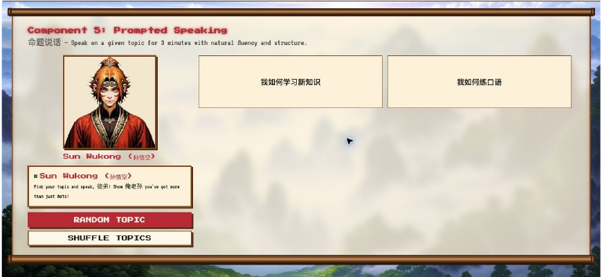

<h1 align="center">A Mandarin practice session with a journey to follow.</h1>

Speak, listen and try again—with companions from Journey to the West.

<a href="https://github.com/baduru11/XiYouQuest-RPG-study-web">Explore the team project</a> · <a href="#my-contribution">My contribution</a>

Actual prompted-speaking interface captured on 18 August 2026. A historical view of the practice experience; current development is linked in the team repository.

## Give the next attempt a reason.

Pronunciation practice asks you to repeat yourself. XiYouQuest gives that repetition a setting: characters, quests and a path through an adventure inspired by Journey to the West.

The point is still to speak. The game gives each attempt a place in a longer journey.

## One attempt leads to the next

| Choose a task | Make an attempt | Hear and improve |
| --- | --- | --- |
| Practise a word, a passage or a speaking topic. | Record your voice within the activity. | Listen back, review formative feedback and try again. |

The current team project combines pronunciation activities, prompted speaking, companion conversations and PSC-format practice. Supplementary drills extend the practice beyond the five-component mock format. Feedback supports learning; it is not an official PSC result or proficiency certification.

## My contribution

XiYouQuest is a team project. I contribute to planning, interface work, backend implementation and testing.

One small detail captures the work well: learners should be able to hear the reference and replay their own attempt without the two interfering. [This contribution](https://github.com/baduru11/XiYouQuest-RPG-study-web/commit/2469cefd609cba3154a87a52138dc824160a5ea4) connects that learning need with playback behaviour, recording controls and regression tests.

It is the same approach I bring to mentoring: take an idea people can understand, turn it into a working experience and inspect the details that determine whether it helps.

## Follow the development

[The public team repository](https://github.com/baduru11/XiYouQuest-RPG-study-web) contains the current project description, development history and technical documentation. This page is a product introduction, rather than a claim that every service is available as a public hosted demo.

---

[More projects by Hyunjun Kim](https://github.com/EricEremos) · [Get in touch](https://www.linkedin.com/in/ericmos/)
