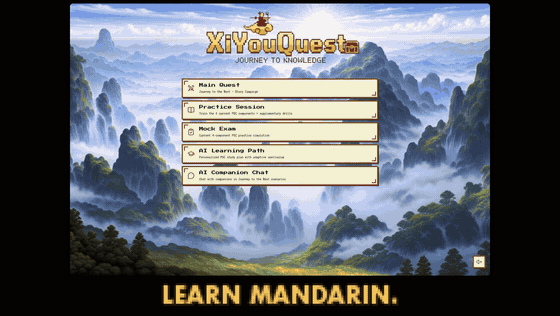
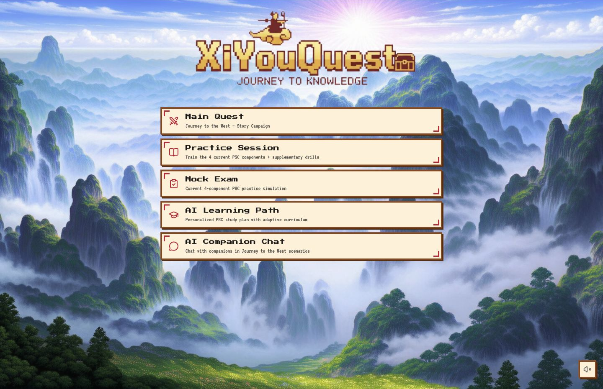
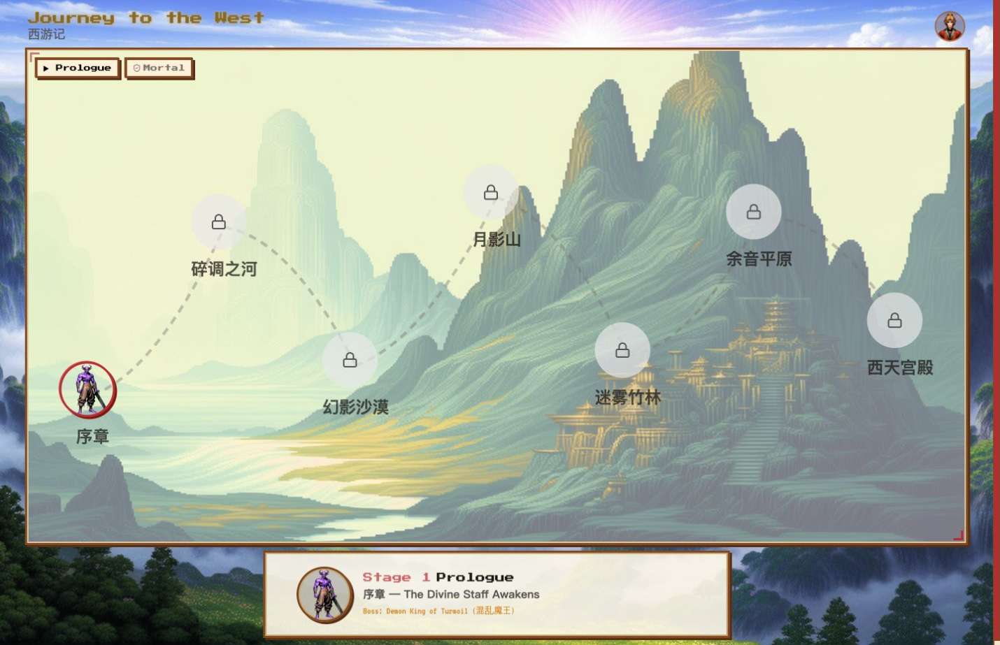
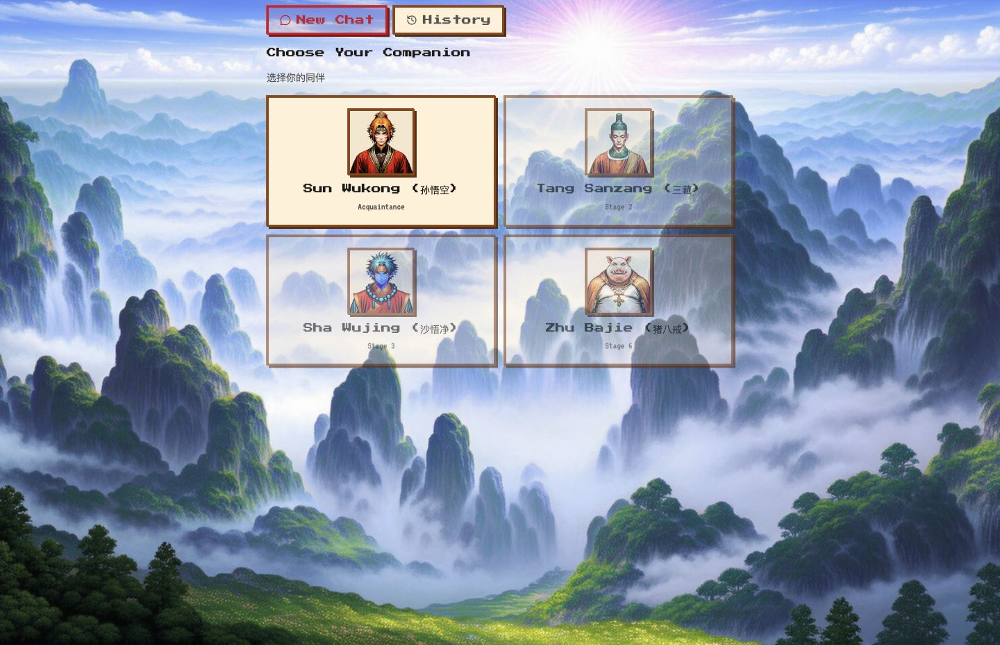
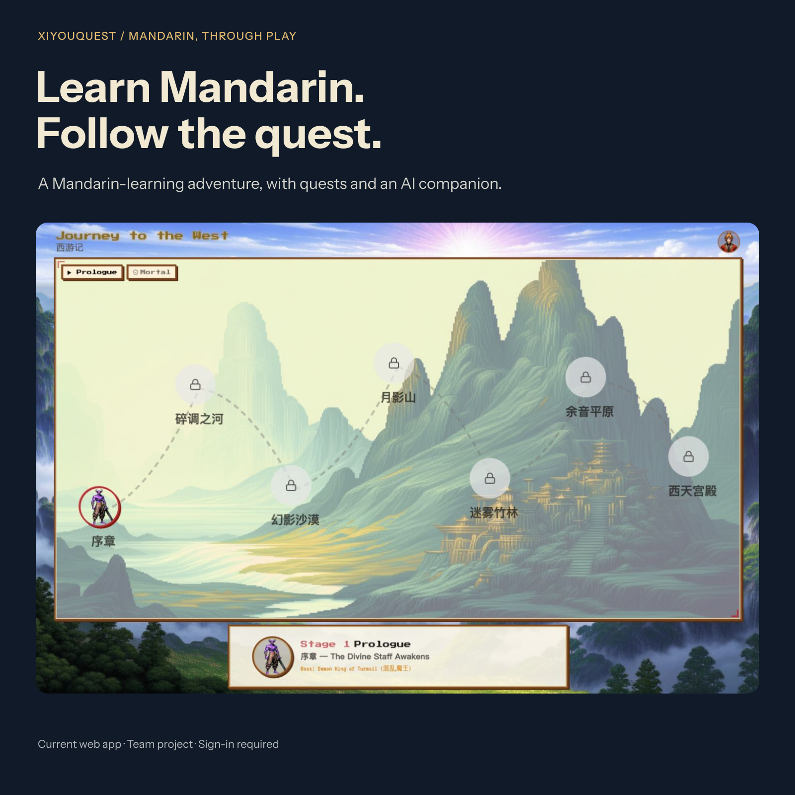

<strong>XiYouQuest · Journey to Knowledge</strong>

<h1 align="center">Learn Mandarin. Follow the quest.</h1>

A story to follow, speaking to practise and companions to meet along the way.

<b>Winner · HKUST GenAI Hackathon 2026 · Team project</b>

<a href="https://cle-xyq.hkust.edu.hk">Visit XiYouQuest</a> · <a href="https://github.com/baduru11/XiYouQuest-RPG-study-web">Explore the team project</a> · <a href="#my-contribution">My contribution</a> The live learning site requires HKUST sign-in. Explore the captured interface below without an account.

Team project with institutional access. Animated product screenshots, with game art from the project repository. Stages are previewed, not played; no exercise was submitted, no speaking feedback is shown and no learning outcome is claimed. <a href="assets/xiyouquest-promo-20261024.mp4">Watch the full film</a> · <a href="assets/xiyouquest-promo-20261024-poster.png">Still frame</a> · <a href="assets/xiyouquest-promo-20261024-manifest.json">Capture details</a>

## Give the next attempt a reason

Pronunciation practice involves trying again. XiYouQuest places those attempts inside an adventure inspired by *Journey to the West*: a new destination ahead, a companion to talk with and a reason to return to the journey.

### Choose how to practise

The learning hub brings together the story campaign, pronunciation and speaking exercises, mock practice, an AI learning path and companion conversations. Start with a focused exercise or follow the story from the same place.

### See the next destination

The seven-stage map leads through rivers, mountains and forests towards the Western Palace. Locked stages make the route ahead visible before they become available.

### Meet someone along the way

Begin with Sun Wukong. Later-stage requirements introduce Tang Sanzang, Sha Wujing and Zhu Bajie, connecting companion conversations with progress through the story.

## My contribution

XiYouQuest is a **team project and HKUST GenAI Hackathon 2026 winner**. I contribute to planning, interface work, backend implementation and testing.

One detail shows how those responsibilities meet: a learner needs to hear the reference and replay their own attempt without the two interfering. [My playback contribution](https://github.com/baduru11/XiYouQuest-RPG-study-web/commit/2469cefd609cba3154a87a52138dc824160a5ea4) follows that learning need through recording controls, playback behaviour and regression tests.

The journey gives the practice its setting. The implementation has to make each attempt usable.

## Explore XiYouQuest

- [Open the learning site](https://cle-xyq.hkust.edu.hk) — HKUST sign-in required.
- [Read the public team repository](https://github.com/baduru11/XiYouQuest-RPG-study-web) — documentation, development history and contributions.

Capture details and learning context

These production screens were captured on 22 October 2026. Account navigation is excluded. The campaign card was curated in Figma around the original map; select it to inspect that capture.

The practice catalogue includes pronunciation, reading, prompted speaking and supplementary drills. Mock practice does not issue an official PSC result or proficiency certification. The screens document product states; they do not establish learning outcomes or the accuracy of automated feedback.

---

[More projects by Hyunjun Kim](https://github.com/EricEremos) · [Get in touch](https://www.linkedin.com/in/ericmos/)
